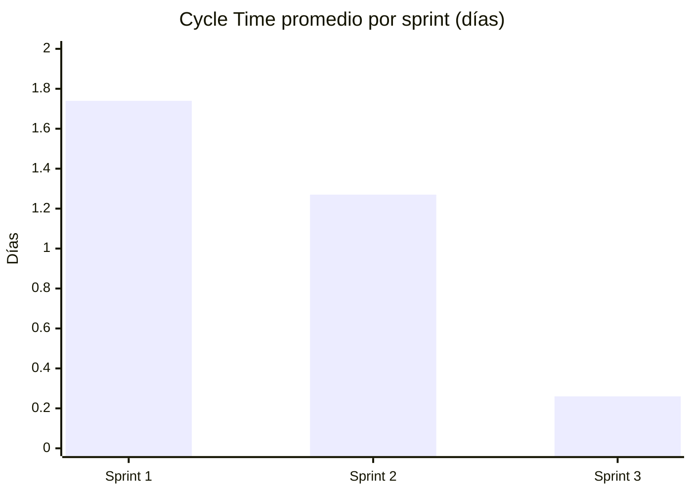
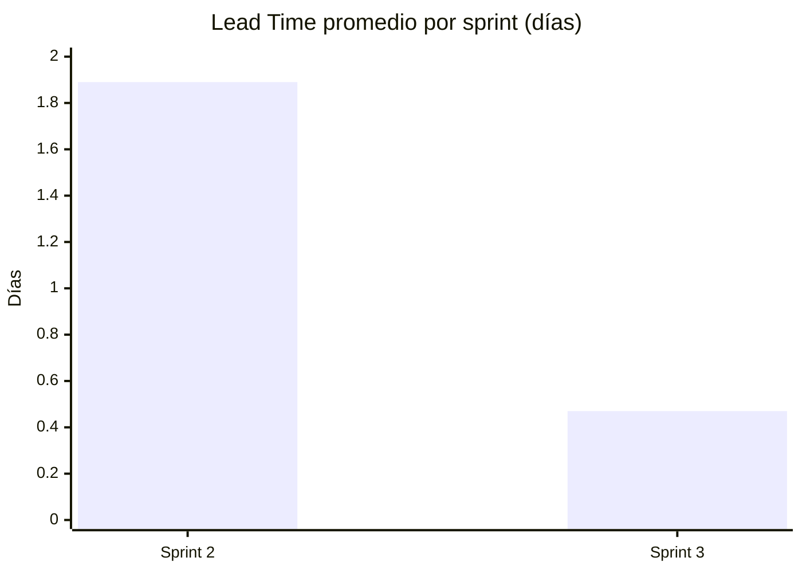
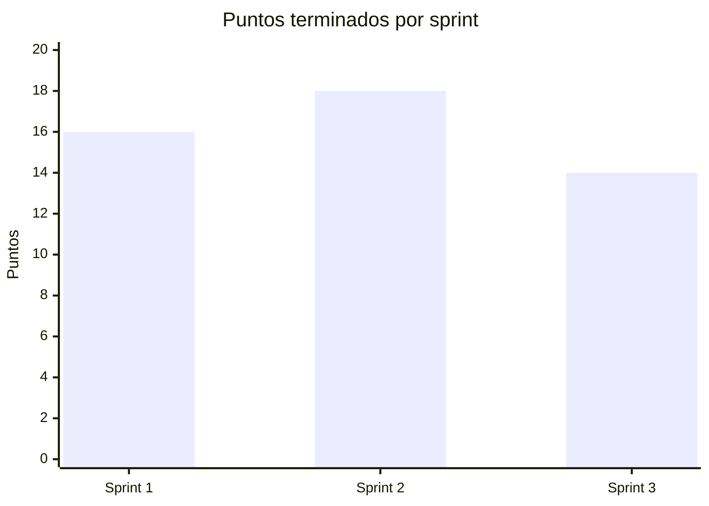

# Métricas consolidadas y comparación de sprints

> Issue #41 · Consolidado al 2026-10-13, después de la retrospectiva del Sprint 3.
> Fuentes: [`seguimiento.xlsx`](seguimiento.xlsx) (pestañas Historias, WIP diario, Bloqueos, Defectos y Resumen por sprint) y las retrospectivas de los sprints [1](../retrospectivas/sprint-1.md), [2](../retrospectivas/sprint-2.md) y [3](../retrospectivas/sprint-3.md).
> No se agregó ningún dato nuevo: todo sale de esas fuentes o de GitHub. Donde algo no se registró, se dice.

## 1. Tabla por sprint

| Métrica | Sprint 1 | Sprint 2 | Sprint 3 | Total |
|---|---|---|---|---|
| Historias comprometidas | HU-01, 02, 03, 05 | HU-04, 06, 07, 08 | HU-09, 10, 11, 12 | 12 |
| Puntos comprometidos / terminados | 16 / 16 (100 %) | 18 / 18 (100 %) | 14 / 14 (100 %) | 48 / 48 (100 %) |
| Throughput (HU en Done) | 4 | 4 | 4 | 12 |
| Días de retraso sobre el plan | 3 | 1 | 0 (1 sobre el cronograma original) | — |
| Lead Time promedio (días) | — (no se registró Ready) | 1,89 | 0,47 | — |
| Cycle Time promedio (días) | 1,74 | 1,27 | 0,26 | 1,09 |
| WIP diario (análisis · atención · validación) | No registrado | No registrado | No registrado | — |
| Máximo de HU en curso a la vez ¹ | 4 | 4 | 4 | — |
| Bloqueos (cantidad · días) | 0 · 0 | 0 · 0 | 0 · 0 | 0 · 0 |
| Defectos encontrados | 1 (DEF-01, P1) | 1 (DEF-02, P3) | 1 (DEF-03, P3) | 3 |
| Defectos abiertos al cierre del sprint | 0 | 1 (DEF-02, cerrado en el Sprint 3) | 0 | 0 hoy |
| PR con la espera más larga hasta el merge | #63, unas 17 h | #82, unas 9,5 h | #110, unas 8,3 h | — |

¹ No es el WIP de la política: es una aproximación calculada con la pestaña **Historias**, contando cuántas historias estaban a la vez entre *En análisis* y *Done*. Con 4 historias por sprint, el máximo fue siempre 4, por debajo del límite total de 8 (3 + 3 + 2). El WIP por columna no se puede reconstruir porque no se anotaron las fechas de *En atención* ni de *En validación*.

### Por historia

| Sprint | HU | Puntos | Lead Time (días) | Cycle Time (días) |
|---|---|---|---|---|
| 1 | HU-01 | 5 | — | 1,65 |
| 1 | HU-02 | 3 | — | 1,97 |
| 1 | HU-03 | 3 | — | 1,96 |
| 1 | HU-05 | 5 | — | 1,39 |
| 2 | HU-04 | 3 | 1,76 | 1,41 |
| 2 | HU-06 | 5 | 1,88 | 1,01 |
| 2 | HU-07 | 5 | 1,96 | 1,08 |
| 2 | HU-08 | 5 | 1,96 | 1,60 |
| 3 | HU-09 | 3 | 0,44 | 0,24 |
| 3 | HU-10 | 5 | 0,44 | 0,24 |
| 3 | HU-11 | 3 | 0,51 | 0,30 |
| 3 | HU-12 | 3 | 0,51 | 0,29 |

Lead Time = Done − Ready y Cycle Time = Done − En análisis, como define la hoja. Las fechas de cada columna no se anotaron el mismo día: se tomaron de git y GitHub con la fecha más probable, y cada fila de la hoja lo explica en *Observaciones*.

## 2. Gráficas

GitHub dibuja estas gráficas a partir del bloque `mermaid`. Debajo de cada una está la misma información en texto.

### Cycle Time y Lead Time promedio (días)





```
Cycle Time   Sprint 1  ██████████████████  1,74
             Sprint 2  █████████████       1,27
             Sprint 3  ███                 0,26

Lead Time    Sprint 1  (no registrado)
             Sprint 2  ███████████████████ 1,89
             Sprint 3  █████               0,47
```

### Throughput, retraso y defectos



```
Puntos terminados   Sprint 1  ████████████████    16
                    Sprint 2  ██████████████████  18
                    Sprint 3  ██████████████      14

Días de retraso     Sprint 1  ███  3
                    Sprint 2  █    1
                    Sprint 3       0

Defectos            Sprint 1  █  1 (P1)
                    Sprint 2  █  1 (P3)
                    Sprint 3  █  1 (P3)

Bloqueos            Sprint 1, 2 y 3: 0
```

## 3. Comparación entre momentos

### Sprint 1 frente a Sprint 3

| Aspecto | Sprint 1 | Sprint 3 | Cambio |
|---|---|---|---|
| Cycle Time promedio | 1,74 días | 0,26 días (unas 6,4 h) | 6,7 veces menor |
| Retraso sobre el plan | 3 días | 0 días | Se terminó en la fecha del Planning |
| Espera más larga de un PR | unas 17 h (#63) | unas 8,3 h (#110) | Menos de la mitad |
| Defectos | 1 P1 (corrompía los datos) | 1 P3 (mensaje de error) | Menos graves |
| PR fusionados por su propio autor | 1 (#57) | 0 | Se corrigió |
| Fechas del tablero anotadas el mismo día | No | No | Sin cambio |

**Qué explica la mejora de tiempos:** desde el Sprint 2 el Planning fijó un orden de trabajo y una tabla de dependencias que permitieron avanzar en paralelo, y los PR se revisaron el mismo día ([retro del Sprint 2](../retrospectivas/sprint-2.md)). El Sprint 3 además comprometía menos puntos (14).

**Qué no explica:** en el Sprint 3 los cuatro commits BACK se hicieron entre las 03:10 y las 03:39 del 13 oct, así que el trabajo pudo empezar antes y el Cycle Time real puede ser algo mayor ([retro del Sprint 3](../retrospectivas/sprint-3.md)).

## 4. Efecto de las mejoras de cada retrospectiva

| Retro | Mejora acordada | Se midió en | Resultado | ¿Efecto observable? |
|---|---|---|---|---|
| Sprint 1 | Ningún PR se fusiona sin revisión, nadie fusiona su propio PR y todo PR lleva `Closes #N`. Además, mejorar los tiempos. | Sprint 2 | 0 PR fusionados por su autor; `Closes #N` en todos los PR que cerraban issue; 2 PR de QA (#89 y #91) fusionados sin revisión. Cycle Time de 1,74 a 1,27 días, retraso de 3 a 1 día y espera máxima de 17 h a 9,5 h. | **Sí, en lo principal.** Desapareció el auto-merge y bajaron los tiempos. Quedaron PR de QA sin revisión. |
| Sprint 2 | Toda revisión queda registrada en GitHub: cada PR se fusiona solo con una review **Approve**, y una auditoría con cambios pendientes no se fusiona sin corregir o registrar el defecto. | Sprint 3 | 14 de 14 PR sin review Approve. 9 de 9 PR de desarrollo con auditoría escrita (como comentario). 0 de 5 PR de QA y docs revisados. 0 PR fusionados con cambios pendientes sin defecto registrado. | **No en lo que pedía.** La revisión existe, pero como comentario. Sí se cumplió registrar los defectos (DEF-03). |
| Sprint 3 | El veredicto de la auditoría es la review: se publica como **Approve** o **Request changes** en GitHub, también en los PR de QA y docs. | PR posteriores a la retro (sección 5) | Ver la sección 5. | **Todavía no.** |

### Tendencia de la práctica de revisión

| Indicador | Sprint 1 | Sprint 2 | Sprint 3 |
|---|---|---|---|
| PR fusionados por su propio autor | 1 (#57) | 0 | 0 |
| PR fusionados sin ninguna revisión | 2 (#49 y #57) | 2 (#89 y #91) | 5 (los de QA y docs) |
| PR con review **Approve** | — (no se medía) | 4 (#81, #83, #94 y #95) | 0 de 14 |

La revisión pasó de no existir a hacerse siempre en los PR de desarrollo, pero quedó como comentario. Esa es la brecha que ataca la mejora del Sprint 3.

## 5. Después de la retro del Sprint 3

La retro del Sprint 3 se fusionó con el PR #124 el 2026-10-13 a las 11:05 (hora de Colombia). Desde entonces, según GitHub:

| PR | Qué es | Estado | Review Approve | Observación |
|---|---|---|---|---|
| #125 | Corrección del DEF-03 (#123) | Fusionado 2026-10-13 11:35 | No | Se fusionó con la auditoría como comentario y sin review. El título empieza por `ix(casos)` en vez de `fix(casos)`, fuera de la convención. |
| #126 | Cierre del DEF-03 en la hoja y las pruebas (#123) | Abierto | No, pendiente | |
| #127 | Casos de prueba propios CP-11 a CP-18 (#38) | Abierto | No, pendiente | |
| #128 | README de instalación (#39) | Abierto | No, pendiente | |
| #129 | Requisitos y trazabilidad (#40) | Abierto | No, pendiente | |

**Incidente del proceso (2026-10-13):** el PR #125 es el primero después de acordar la mejora del Sprint 3 y se fusionó igual que antes, sin review **Approve** y con un error en el título. La mejora todavía no tiene efecto observable. Los PR #126 a #129 y el de esta issue son la siguiente oportunidad de medirla: la meta es que cada uno tenga una review **Approve** de otro integrante antes del merge.

## 6. Lo que las métricas no pueden mostrar

- **WIP diario:** no se registraron dailies ni capturas del tablero en ningún sprint, y las columnas del Project no coinciden con las de la política. Por eso la pestaña **WIP diario** está vacía y no hay datos de WIP excedido.
- **Lead Time del Sprint 1:** no se registró la entrada a Ready.
- **Fechas por columna:** todas se reconstruyeron con la fecha más probable a partir de git y GitHub, como permite la regla de la hoja, y cada una está explicada en *Observaciones*.

Este hallazgo se repitió en las tres retrospectivas sin que se resolviera: es la principal acción pendiente del proceso, junto con la review **Approve**.
